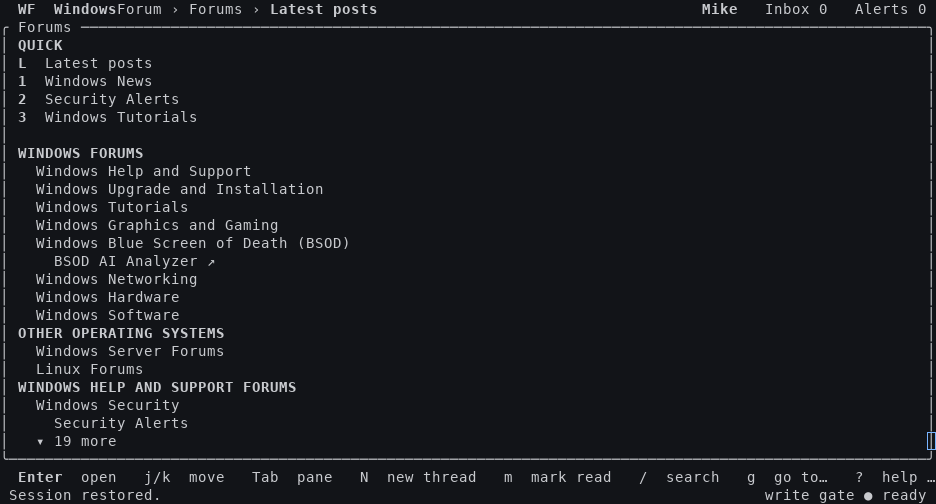

# Forum Terminal (TUI) — `wftui`

A terminal client for [XenForo 2.3](https://xenforo.com) forums, written in pure Rust. Browse forums and threads, read and post replies, start threads, exchange conversation (direct) messages, check alerts, search, and view profiles — without leaving the terminal. It renders BBCode with the author's styling, shows inline images when your terminal supports them, keeps composer drafts (shared with the website editor where the forum supports it), and updates itself from GitHub releases.

It runs locally or over SSH, with full keyboard and mouse support. There is no local forum database and no background daemon: the client talks to the forum's REST API (`{origin}/api`) over HTTPS with your OAuth session, and throttles itself so it stays polite to the forum.

**Who it is for:** members who live in the terminal and want to read and participate in a XenForo 2.3 forum there — including over SSH, where the sign-in flow is designed to work from another device.

Two editions build from this one repository. The command is `wftui` in both:

| Edition | Built-in site | Get it with |
|---|---|---|
| **Forum Terminal (TUI)** | windowsforum.com — no config needed | default release assets (no suffix) |
| **Terminal for XenForo** | none — asks on first run | release assets with `-xf`, or a source build without the built-in site (see [Building from source](#building-from-source)) |

<p align="center">
  
</p>

Current version: **0.0.5** (see `version` in [wftui/Cargo.toml](wftui/Cargo.toml)).

## Quick start

### Install from a release (recommended)

**Linux (x86_64):**

```sh
curl -fsSL https://raw.githubusercontent.com/faratech/forumtui/main/packaging/install.sh | sh
```

**Windows (x64 / x86 / arm64) — PowerShell, portable exe:**

```powershell
irm https://raw.githubusercontent.com/faratech/forumtui/main/packaging/install.ps1 | iex
```

**Windows — signed MSIX (recommended on Windows):** download `wftui-<version>.msixbundle` from [Releases](https://github.com/faratech/forumtui/releases) and install it:

```powershell
Add-AppxPackage .\wftui-<version>.msixbundle
```

The MSIX puts `wftui.exe` on your PATH via an execution alias, so `wftui` runs from any new shell.

Both install scripts fetch the latest GitHub release, verify the download against the release's `SHA256SUMS.txt`, and install with an atomic rename (a running `wftui` is never replaced mid-file). Useful knobs:

```sh
WFTUI_EDITION=xf sh install.sh            # Terminal for XenForo edition
WFTUI_INSTALL_DIR=/opt/bin sh install.sh  # where to put the binary
```

```powershell
.\install.ps1 -Edition xf -InstallDir D:\tools
```

Without `WFTUI_INSTALL_DIR`, `install.sh` uses `/usr/local/bin` when writable, otherwise `~/.local/bin`. `install.ps1` defaults to `%LOCALAPPDATA%\wftui`.

**Manual:** download `wftui-<version>-<platform>` (or the `.tar.gz`) from [Releases](https://github.com/faratech/forumtui/releases) and check its SHA-256 against `SHA256SUMS.txt` before running it.

**macOS:** no build ships yet — `install.sh` says so and points you at the issue tracker. Building from source on macOS is not a supported release path.

Release platforms, as built by [.github/workflows/release-binaries.yml](.github/workflows/release-binaries.yml): Linux `x86_64` only, and Windows `x64`/`x86`/`arm64`. There is currently no Linux aarch64 release asset.

### Building from source

Requires Rust **1.99.1** (pinned by [rust-toolchain.toml](rust-toolchain.toml); `rustup` picks it up automatically). No C toolchain is needed — the dependency graph is pure Rust.

```sh
git clone https://github.com/faratech/forumtui
cd forumtui
cargo install --path wftui          # Forum Terminal (TUI) edition
wftui --version                     # prints: wftui 0.0.5
```

Edition variants:

```sh
cargo install --path wftui --no-default-features --features images
# Terminal for XenForo: no built-in site, first run shows the Setup screen

cargo build --release -p wftui --no-default-features
# text-only build: no image decoder compiled in (images fall back to text)
```

Then just run it:

```sh
wftui
```

## First run and signing in

### Built-in edition (windowsforum.com)

Run `wftui`. There is nothing to configure. On the sign-in screen press **Enter** to begin. The client obtains an authorization code with OAuth 2.0 (authorization code + PKCE S256, public client — no secret is embedded) in this order (`login: "auto"`, the default):

1. **Relay (TuiLink)** — if the forum answers `POST /api/wf-tuilink/register`, the client shows a short link such as `https://<forum>/tui-start/<id>`. Open it on any device (a phone works, including while you are connected over SSH), approve, and the code returns to the client on its own. A 404 means the add-on is not installed and the client moves on; any other failure is reported.
2. **Loopback** — the client listens on `127.0.0.1` (port `9420` first, else an ephemeral port) and opens `/oauth2/authorize` in a browser on this machine. Approval redirects straight back.
3. **Paste** — if no listener could be bound, the browser lands on a `http://127.0.0.1/callback?...` address that will not load. Paste that address (or just the `code=` value) into the field and press Enter. The pasted address is checked against the request's `state`; a bare code is still bound to this process by the PKCE verifier.

On the sign-in screen: **Enter** begins/restarts sign-in, **m** cycles the mode for the next attempt (`auto` → relay → loopback → paste), **p** switches to paste, **c** copies the link, **o** opens it here, **q** quits. While a sign-in is in flight only **q** is live.

Sessions refresh silently. The token set (2-hour access token, 90-day refresh token) is stored as JSON with `0600` permissions on Unix, written atomically, at:

```text
Linux:   ~/.config/wftui/token.json
Windows: %APPDATA%\wftui\token.json
any:     $WFTUI_CONFIG_DIR/token.json
```

Press **Ctrl+L** at any time to sign out. A token store that belongs to a different site or OAuth client is never used; it is set aside as `token.json.foreign` and a fresh sign-in starts.

### Terminal for XenForo edition (no built-in site)

The first run shows a **Setup screen** with three fields — forum address (`https://forum.example.com`), the OAuth client ID your admin gave you, and a forum name. **Tab** moves between fields, **Ctrl+Y** pastes, **Enter** submits, **Esc** quits. On success it writes `config.json` (see [Configuration](#configuration)) and continues to the sign-in screen above.

## What you can do

- **Browse** the forum tree and thread lists (Home screen, dual-pane from 110 columns), open threads, step through posts page by page, mark forums/threads read (**m**), and refresh (**r** / **R** depending on screen).
- **Read** posts with BBCode styling (quotes, spoilers hidden until **x**, code, colours quantized to your terminal), links (**o** opens the link list, **u** opens the thread on the web), and inline images.
- **Post**: reply (**r**), quote (**Q**), edit (**e**) and delete (**D**) your posts where the API permits, start a thread (**N**), attach files in the composer (**Ctrl+F**), preview (**Ctrl+O**), send (**Ctrl+S**).
- **Conversations and alerts**: inbox with Conversations/Alerts tabs (**c** / **a**, or **g i** / **g a**), read, reply, and start new messages (**n** in the inbox).
- **Search** (**/** or **s**): query with type (**t**) and order (**o**) controls, including Media Gallery and Resource Manager types on forums that have them.
- **Media Gallery / Resources** (**g m** / **g r**) on forums running XFMG/XFRM: browse, view an image full-pane (**Enter**), download or open on the web from a resource (**d** / **o**).
- **Profiles**: author/starter profiles from a thread or conversation (**p** / **P**), and your own via **g p**.
- **Drafts** (**g d**): every unsent draft in one list; resume with **Enter**, delete with **D**. See [Drafts and the image cache](#drafts-and-the-image-cache).
- **Ask the AI** (**g k**, WindowsForum only): a chat screen backed by that site's assistant. It does not exist on other forums.
- **Self-update**: press **g u** to check now; updates are verified and staged, then applied at the next start. See [Self-update](#self-update).

The key bar at the bottom always shows the keys that work on the current screen, and **?** opens the full keys card. You never need to memorize this README's tables to use the client.

## Controls

All bindings below are taken from the input handlers and per-screen hint bars in `wftui/src/`. When a text field owns the keyboard (composer, search edit, Setup, paste field), letter keys type text and the navigation bindings are suspended — the key bar shows what is live.

### Everywhere (once signed in)

| Keys | Action |
|---|---|
| `?` | Keys card (any key closes it) |
| `Ctrl+K` or `:` | Go-to palette (fuzzy search over forums, actions, members) |
| `g` then a letter | Go-to chord — see below |
| `G` | Bottom of the current list/thread |
| `c` | Inbox — Conversations tab |
| `a` | Inbox — Alerts tab |
| `s` or `/` | Search |
| `Esc` | Back one level (at Home: quit; in a pane: return focus to the list/tree) |
| `q` | Quit (on pushed screens: back one level) |
| `Ctrl+L` | Sign out |
| `Ctrl+C` | Copy the current selection |
| `Ctrl+Y` | Paste (OSC 52 — works in tmux and over SSH) |
| `r` | Retry, when a failed load offers it |

### Movement

| Keys | Action |
|---|---|
| `j` / `k` or `↑` / `↓` | Move one line / scroll |
| `n` / `N` | Next / previous post (or message, in a conversation) |
| `[` / `]` | Previous / next page |
| `g g` | Top |
| `Tab` | Switch pane (Home, Inbox, Media Gallery) |

### `g` chords (go-to)

Press `g`, then one letter. The which-key panel appears bottom-right; `Esc` or an unbound letter cancels and costs nothing.

| Chord | Destination |
|---|---|
| `g l` | Latest threads |
| `g i` | Inbox |
| `g a` | Alerts |
| `g m` | Media Gallery (only if the site has XFMG) |
| `g r` | Resources (only if the site has XFRM) |
| `g k` | Ask the AI (only if the site enables it) |
| `g d` | Drafts |
| `g h` | Home |
| `g p` | Your profile |
| `g g` | Top of the current screen |
| `g u` | Check for an update now |
| `g <key>` | The site's quick destinations, if configured (also `1`–`9` on Home) |

### Palette

`Ctrl+K` / `:` opens the go-to palette. Type to filter (whitespace is ignored, matching is subsequence/fuzzy), `↑`/`↓` or `Ctrl+N`/`Ctrl+P` to move, `PageUp`/`PageDown` by page, `Enter` to go, `Esc` to close.

### Per-screen keys (highlights)

| Screen | Keys |
|---|---|
| Home | `Enter` open, `N` new thread, `m` mark read, `1`–`9` quick destinations |
| Thread list | `Enter` read, `N` new thread, `m` mark read, `r` refresh |
| Thread view | `r` reply (or resume draft), `Q` quote, `W` open video, `e` edit, `D` delete, `l` like/react, `v`/`V` vote, `o` links, `x` reveal/hide spoilers, `u` open on web, `R` retry on error |
| Composer | `Ctrl+S` send/post, `Ctrl+O` preview, `Ctrl+F` attach, `Ctrl+X` discard a resumed draft, `Ctrl+Y` paste, `Tab` next field (new thread) or indent, `Esc` close (draft is kept) |
| Inbox (list) | `Enter` open/read, `Tab` switch Conversations/Alerts, `n` new message, `m` mark read, `R` refresh |
| Inbox (view pane) / Conversation | `r` reply, `n`/`N` next/previous message, `x` spoilers, `p`/`P` author/starter profile, `[` `]` page |
| Search | `Enter` open/search, `i` edit query / new search, `t` result type, `o` order, `[` `]` page |
| Media Gallery | `Enter` browse/view, `o` open on web, `Tab` pane, `R` refresh |
| Resources / Resource view | `Enter` view, `d` download, `o` open on web, `R` refresh |
| Drafts | `Enter` resume, `D` delete |
| Ask the AI | `i` ask, `Enter` send question, `y` copy answer, `1`–`9` open source, `n` / `Ctrl+N` new chat, `o` open web |
| Sign-in | `Enter` begin/restart, `m` cycle mode, `p` paste code, `c` copy link, `o` open here |
| Setup (-xf first run) | `Tab` next field, `Ctrl+Y` paste, `Enter` submit, `Esc` quit |

Thread-view keys that the API does not permit for the selected post (edit, delete, react, vote) are not advertised and do nothing — the bar only shows live keys.

### Mouse and clipboard

Mouse capture is on by default. Click selects (a second click on a row opens it), double-click selects a word, triple-click a line, drag selects and copies on release, right-click opens the target on the website, and the wheel scrolls. `Shift+drag` gives you the terminal's native selection for one drag. Set `WFTUI_MOUSE=0` to disable capture permanently so every gesture and the scrollback belong to the terminal. Copying uses OSC 52 plus the system clipboard where available, so selections survive SSH and tmux.

## Connecting it to your own forum

Any XenForo 2.3 forum works with the -xf edition (or as an extra site in the built-in edition). Nothing needs installing on the server for the basic client: XenForo 2.3 ships the OAuth server and REST API the client uses.

### What the forum admin does (once)

In the Admin CP, **Setup → Service providers → OAuth clients → Add OAuth client**:

- **Client type: public.** The client is PKCE-only and holds no secret.
- **Redirect URIs:** `http://127.0.0.1/callback`. XenForo matches loopback redirect URIs regardless of port, so this one entry covers every sign-in mode. (`localhost` is *not* treated as loopback — use the IP.) If the TuiLink add-on is installed, also add `https://<forum>/tui-done`.
- **Scopes:** at least the twelve base scopes
  `node:read thread:read thread:write user:read conversation:read conversation:write alert:read search:read search:write attachment:read attachment:write profile_post:read`,
  plus `media:read` if the Media Gallery and `resource:read` if the Resource Manager are installed and enabled for the site (see `features` below). Asking for a scope the client does not grant fails the whole sign-in.

Save, and give users the **client ID** (it is public) for their configuration. That is the whole server side.

### Optional: the TuiLink add-on

The [`WindowsForum/TuiLink`](addon/README.md) add-on in [`addon/`](addon/) adds the short any-device sign-in link (`/api/wf-tuilink/*`) and the draft relay (`/api/wf-tui-drafts`), so a reply started in the terminal is waiting in the website's editor and vice versa. Without it, sign-in uses loopback or paste, and drafts stay local to the client. Install the add-on, set its *TuiLink → OAuth client ID* option, and add the `tui-done` redirect URI above. Full routes and install steps: [addon/README.md](addon/README.md). From the repo root, `./deploy-addon.sh` exports the add-on into a XenForo installation.

### What each user does

Either let the -xf edition's Setup screen ask on first run, or write `config.json` yourself (`wftui --init-config` writes an annotated example):

```sh
wftui --init-config   # writes the example; refuses to overwrite an existing file
wftui example         # run against the site named "example"
wftui --print-config  # show the resolved site, token store, user agent, scopes
```

Full configuration reference: [docs/CONFIG.md](docs/CONFIG.md).

## Configuration

One JSON file names every forum the client may talk to. There is one site per process.

```text
Linux:   ~/.config/wftui/config.json
Windows: %APPDATA%\wftui\config.json
any:     $WFTUI_CONFIG_DIR/config.json
```

### Picking a site (first match wins)

1. `wftui <name>` or `wftui --site <name>` (short form `-s`)
2. the `WFTUI_SITE` environment variable
3. `default_site` in the file
4. the only site the file lists, if it lists exactly one
5. `windowsforum` (built-in edition)

An unknown name is an error that lists the known ones. A file that does not parse is a hard error naming the line and column — the client never falls back to the default site over a broken config.

### The file

Every field of a site is optional. An entry named `windowsforum` overrides only the fields it names; any other name starts blank and needs at least `origin` and `oauth_client_id`. Unknown keys (and `_comment`) are ignored, so a file written for a newer build loads on an older one.

```json
{
  "default_site": "windowsforum",
  "sites": [
    { "name": "windowsforum" },
    {
      "name": "example",
      "origin": "https://forum.example.com",
      "oauth_client_id": "PASTE-CLIENT-ID",
      "login": "auto",
      "features": { "xfmg": false, "xfrm": false, "tuilink": null, "drafts_relay": null, "ask_ai": false },
      "brand": {
        "name": "ExampleForum",
        "bold_prefix": "Example",
        "mark": "EX",
        "chrome_bg": "#3A7D44",
        "logo": null
      },
      "quick": [ { "key": "n", "label": "News", "node_id": 12 } ],
      "bot_user_ids": [],
      "prefix_strip": []
    }
  ]
}
```

| Field | Meaning | Default |
|---|---|---|
| `name` | slug: lowercase letters, digits, dashes; also the `sites/` directory name | required |
| `origin` | forum origin, `https://host` — no path, query, or credentials | required (WF: `https://windowsforum.com`) |
| `oauth_client_id` | the public OAuth client ID from the Admin CP | required (WF: built in) |
| `scopes` | explicit scope list; omit to derive from `features` | derived |
| `features.xfmg` / `features.xfrm` | forum runs Media Gallery / Resource Manager (adds UI + `media:read` / `resource:read`) | `false` (WF: `true`) |
| `features.tuilink` / `features.drafts_relay` | forum has TuiLink / its draft endpoint (`null` = detect at runtime) | `null` (WF: `true`) |
| `features.ask_ai` | Ask the AI (`g k`) via `/api/wf-tui-ai` — WindowsForum-specific, leave `false` elsewhere | `false` (WF: `true`) |
| `login` | `auto`, `tuilink`, `loopback`, or `paste` | `auto` |
| `brand.name` / `brand.bold_prefix` / `brand.mark` / `brand.chrome_bg` / `brand.logo` | header/sign-in wordmark, bold lead, 1–4 char chip, header colour (any CSS colour), sign-in PNG (relative to the config dir) | slug-derived (WF: WindowsForum blue) |
| `quick` | up to nine `{key, label, node_id}`: a `g <key>` chord, palette row, and Home `1`–`9` key; `key` must not collide with `l i a m r d h p g u k` | none (WF: news / security / tutorials) |
| `bot_user_ids` | members whose posts wear an `AI` chip | none |
| `prefix_strip` | words dropped from thread prefixes in narrow rows | none (WF: `"Windows "`) |

Each site keeps its own session and drafts: the built-in site directly in the config directory, any other site under `sites/<name>/`. A stored session records the origin and client it was issued for; a store belonging to another site is set aside as `token.json.foreign` rather than used.

See [docs/CONFIG.md](docs/CONFIG.md) for the complete reference, including scope derivation and validation rules.

### Environment variables

For any site field, the environment beats the file, and the file beats the compiled-in default.

| Variable | Effect |
|---|---|
| `WFTUI_CONFIG_DIR` | Config directory (holds `config.json`, `token.json`, `drafts.json`, `wftui.log`, `cache/`, `update/`). Default: `~/.config/wftui` on Linux, `%APPDATA%\wftui` on Windows |
| `WFTUI_SITE` | Site name when no argument names one |
| `WFTUI_BASE_URL` | Overrides the selected site's `origin` (tests/staging) |
| `WFTUI_OAUTH_CLIENT_ID` | Overrides the selected site's `oauth_client_id` |
| `WFTUI_LOG` | Log level / module filter for `wftui.log` (e.g. `WFTUI_LOG=info`); default `warn`. Logging is file-only — the TUI owns the screen |
| `WFTUI_MOUSE` | `0`/`off`/`false`/`no` disables mouse capture |
| `WFTUI_NO_IMAGES` | `1` disables inline images (text tier) |
| `WFTUI_GRAPHICS` | Force a graphics tier: `kitty`, `sixel`, `iterm2`, `halfblocks`, or `none` (skips the terminal capability query; the escape hatch for slow SSH links) |
| `WFTUI_ASCII` | `1` forces ASCII glyphs (also automatic for non-UTF-8 locales via `LC_ALL`/`LC_CTYPE`/`LANG`) |
| `NO_COLOR` | Mono theme and text-only images |
| `WFTUI_NO_UPDATE` | `1` disables the self-updater entirely (no feed check, nothing staged or applied) |
| `WFTUI_UPDATE_URL` | Release-feed URL (default: this repo's GitHub `releases/latest`) |

Installer-only: `WFTUI_EDITION` (`xf` for Terminal for XenForo) and `WFTUI_INSTALL_DIR` for `install.sh`; `-Edition` / `-InstallDir` parameters for `install.ps1`.

### Command line

```text
usage: wftui [<site> | --site <name>] [--print-config] [--init-config] [--version]

  <site>, -s/--site <name>  forum from config.json (or WFTUI_SITE / default_site)
      --init-config         write an annotated example config.json (never overwrites)
      --print-config        print the resolved site, token store, user agent, scopes
  -V, --version             print "wftui <version>"
  -h, --help                this text
```

Unknown options and naming two sites exit with code 2 and a hint on stderr, before the terminal is touched.

## Drafts and the image cache

There is **no offline copy of the forum**. Browsing, reading, searching, and posting all go to the live REST API; with no network (or an expired session that cannot refresh) the client shows the error and offers **r**/**R** to retry. Three things do persist on disk, and they are the whole offline story:

- **Composer drafts** — `drafts.json` beside the token store (`0600`, atomic writes, at most 32 drafts of 256 KiB each). Closing a composer with **Esc** keeps the draft; reopening the same composer offers it back (**Ctrl+X** discards a resumed draft). The Drafts screen (**g d**) lists all of them. Post *edits* always stay local. Thread replies, new threads, and conversation replies also sync to the website's editor through the TuiLink draft relay (`/api/wf-tui-drafts`) when the forum has the add-on, so a draft started in either place is waiting in the other; without the add-on they remain local.
- **Images** — raw thumbnail bytes under `<config dir>/cache/img/`, keyed by a SHA-256 of the URL, capped at 32 MiB total and pruned oldest-first back to 80% on overflow, so a restart or a scroll back up does not re-hit the site. Decoded protocol payloads are additionally kept in a 32-entry in-memory LRU. This is a re-display cache only — it never substitutes for fetching thread content.
- **Session** — `token.json` (above), so restarts do not require signing in again until the 90-day refresh grant expires or is revoked.

Polling is part of staying polite: alerts refresh every 45s and conversations every 90s while you run the client. All API traffic is self-throttled (250 ms minimum spacing, 3 s for search, write cooldowns mirroring the forum's flood limits), and a `429` backs the relevant lane off instead of retrying immediately.

## Terminal and images

- Needs a **UTF-8 terminal**. If the locale is not UTF-8 (or `WFTUI_ASCII=1`), the client falls back to ASCII glyphs and plain borders.
- Inline images use the best tier your terminal offers, detected at startup: **kitty** graphics, **sixel**, **iTerm2** inline images, **half-blocks**, then **text** placeholders. The build without the `images` feature always uses the text tier. Force a tier with `WFTUI_GRAPHICS`, or turn images off with `WFTUI_NO_IMAGES=1`; `NO_COLOR` selects the mono theme and the text tier. Thumbnails are capped at 2 MiB (8 MiB for the full-size viewer) and refused before decode if their declared dimensions are absurd.
- Colours quantize to your terminal's fidelity (truecolor → 256 → 16 → mono). A site's `brand.chrome_bg` is quantized the same way, so pick a colour that survives 16-colour terminals if you target them.
- Works over SSH (that is what relay/paste sign-in and OSC 52 clipboard are for) and in tmux. If the capability query is slow over your link, set `WFTUI_GRAPHICS` to skip it.

## Self-update

Release builds check the GitHub release feed in the background (first check a few seconds after start, then at most every 6 hours), download the bare binary **for the same edition** (a `-xf` build never installs the built-in edition's binary or vice versa), verify it against the release's `SHA256SUMS.txt` and its own executable header, and stage it under `<config dir>/update/`. At the next start, before the terminal is touched, the staged binary replaces the running one with an install-then-rename swap and the session tells you it is still running the old build. Press **g u** to check immediately. `WFTUI_NO_UPDATE=1` turns the whole mechanism off (use it for distro packages and source checkouts — note `bin/wftui` in this repo is a committed release binary); `WFTUI_UPDATE_URL` points the feed elsewhere for testing or staging.

## Project layout

```text
forumtui/
├── Cargo.toml            workspace (members: common, wftui) + release profile
├── rust-toolchain.toml   pins Rust 1.99.1 (clippy + rustfmt components)
├── wftui/                the `wftui` binary (ratatui/crossterm TUI)
│   ├── Cargo.toml        features: images (default), builtin-windowsforum (default)
│   ├── assets/           embedded sign-in logo (built-in edition)
│   └── src/              app/ (event loop, input, actions), screens/, overlay.rs
│                         (palette / which-key / keys card), chrome.rs, editor.rs,
│                         images.rs (graphics tiers + disk cache), theme.rs
├── common/               core library, testable without a terminal
│   └── src/              site.rs (which forum), config.rs (constants + env),
│                         oauth.rs (PKCE sign-in), token.rs (0600 token store),
│                         api.rs (WfApi client + throttle gates), http.rs,
│                         drafts.rs, update.rs (self-updater), bbcode.rs, ai.rs
├── addon/WindowsForum/TuiLink/   XenForo add-on source (PHP) + releases/ zip
├── docs/CONFIG.md        full site-configuration reference
├── docs/demo/            wftui-demo.gif + the script that recorded it
├── packaging/            install.sh / install.ps1, Linux tarball, Windows MSIX
├── bin/wftui             committed release binary (no toolchain needed to run)
├── DESIGN.md             the approved UI contract (screens, row grammar, tiers)
└── CLAUDE.md             contributor guidance (architecture, hard rules, testing)
```

There is exactly one client: no daemon, shim, or supervisor. `common` holds everything that can be tested without a terminal (the `WfApi` trait is the seam — tests substitute fakes and never touch the network or your real config directory); `wftui` holds the terminal front end that consumes it.

## Development

```sh
export WFTUI_CONFIG_DIR=/tmp/wftui-test-cfg   # ALWAYS before cargo test:
                                              # tests must never resolve your
                                              # real ~/.config/wftui
cargo check                                   # while iterating
cargo test --workspace                        # unit + wiremock, both crates
cargo test -p wftui --no-default-features     # the no-images build stays green
cargo test -p common --no-default-features && cargo test -p wftui --no-default-features --features images
                                              # the generic (Terminal for XenForo) edition
cargo test -p wftui thread_row_keeps_exact_width   # one test (substring match)
cargo test -p common bbcode::tests::               # one module
cargo clippy --all-targets --release -- -D warnings   # gate: 0 warnings
cargo build --release                         # binary at target/release/wftui
cargo run -q -p common --example quote_probe -- <message-file> <username> <post_id> <user_id>
                                              # the quote block the client would write
```

CI ([.github/workflows/test.yml](.github/workflows/test.yml)) runs the same test/Clippy feature matrix on Linux, plus the packaging smoke checks (`bash packaging/tests/build-tarball-smoke.sh`) and a guard that no raw escape byte is embedded in `wftui/src`. Release packaging (signed Windows MSIX for x64/x86/arm64, Linux tarball) lives in [packaging/](packaging/README.md) and only runs on a Windows box with the signing kit for the MSIX half.

Read [DESIGN.md](DESIGN.md) before touching a renderer — it is the pixel contract the tests pin — and [CLAUDE.md](CLAUDE.md) for the hard rules and session-lifecycle notes.

## Troubleshooting

- **`unknown site "…"; known sites: …`** — the name is not in `config.json`. `wftui --print-config` shows the resolved site; check `default_site`, `WFTUI_SITE`, and the name you passed.
- **`config.json line N column M: …`** — the file does not parse. The client stops on the normal screen and never falls back to the default site over a broken config. Fix the JSON (unknown keys are fine; duplicate site names are not).
- **`"origin" is required` / `"oauth_client_id" is required`** — a non-built-in site needs both. The client ID is the *public* PKCE client's ID from **Setup → Service providers → OAuth clients**, not a secret.
- **`provided_redirect_uri_is_not_valid` in the browser** — the OAuth client's redirect URIs lack `http://127.0.0.1/callback`, or were registered with `localhost` instead of the IP.
- **Sign-in times out on a forum that has TuiLink** — the OAuth client's redirect URIs lack `https://<forum>/tui-done`. Press **m** on the sign-in screen to use loopback meanwhile.
- **Sign-in seems stuck on the login screen** — while a flow is in flight only **q** works. Press **Enter** to restart it, **m** to change mode, or **p** to paste the redirect address your browser landed on.
- **`token.json.foreign` appeared** — a session for another site or client ID was in that site's directory (a copied config dir, a changed client ID). It was set aside untouched and a fresh sign-in started.
- **A screen 403s with `missing_scope`** — the OAuth client does not grant a scope the client asked for (commonly `media:read`/`resource:read` when `features.xfmg`/`xfrm` are on but the add-ons or scopes are not). Align the client's scopes with [Connecting it to your own forum](#connecting-it-to-your-own-forum) or turn the feature off.
- **Header colour looks wrong in a 16-colour terminal** — `brand.chrome_bg` is quantized to the nearest basic colour there. Pick a colour that survives quantization, or use a 256-colour/truecolor terminal.
- **Images show as text placeholders** — your terminal reported no graphics tier, `WFTUI_NO_IMAGES`/`NO_COLOR` is set, or the build has no `images` feature. Try `WFTUI_GRAPHICS=kitty|sixel|iterm2|halfblocks` if your terminal supports one and detection missed it.
- **Mouse gestures and scrollback belong to the client, not the terminal** — that is mouse capture. Use `Shift+drag` for one native selection, or start with `WFTUI_MOUSE=0`.
- **Startup pauses on a slow SSH link** — the graphics capability query waits for the terminal to answer. Set `WFTUI_GRAPHICS` to skip it.
- **Rate-limited / slow loads** — the client throttles itself (250 ms API spacing, 3 s search) and honours `429` back-off. The wait is shown in the UI; it is not a hang.
- **Crashes and logs** — logging is file-only at `<config dir>/wftui.log` (raise it with `WFTUI_LOG=info`). On a panic the client restores your terminal (raw mode, mouse, alternate screen) before reporting. If an update was staged but not applied, the reason is printed on the normal screen at start.
- **macOS install refuses** — expected: no macOS release ships yet (see [Quick start](#quick-start)).

More sign-in and configuration diagnostics: [docs/CONFIG.md](docs/CONFIG.md#troubleshooting).

## License

MIT — see [LICENSE](LICENSE).

Copyright (c) 2026 Mike Fara. You may use, copy, modify, merge, publish, distribute, sublicense, and/or sell copies of the software under the MIT terms; the copyright and permission notices must be included in all copies or substantial portions, and the software is provided "as is" without warranty of any kind. The full, authoritative text is the [LICENSE](LICENSE) file in this repository. "XenForo" is a trademark of XenForo Ltd.; the generic edition is named *Terminal for XenForo*, never *XenForo Terminal*.
